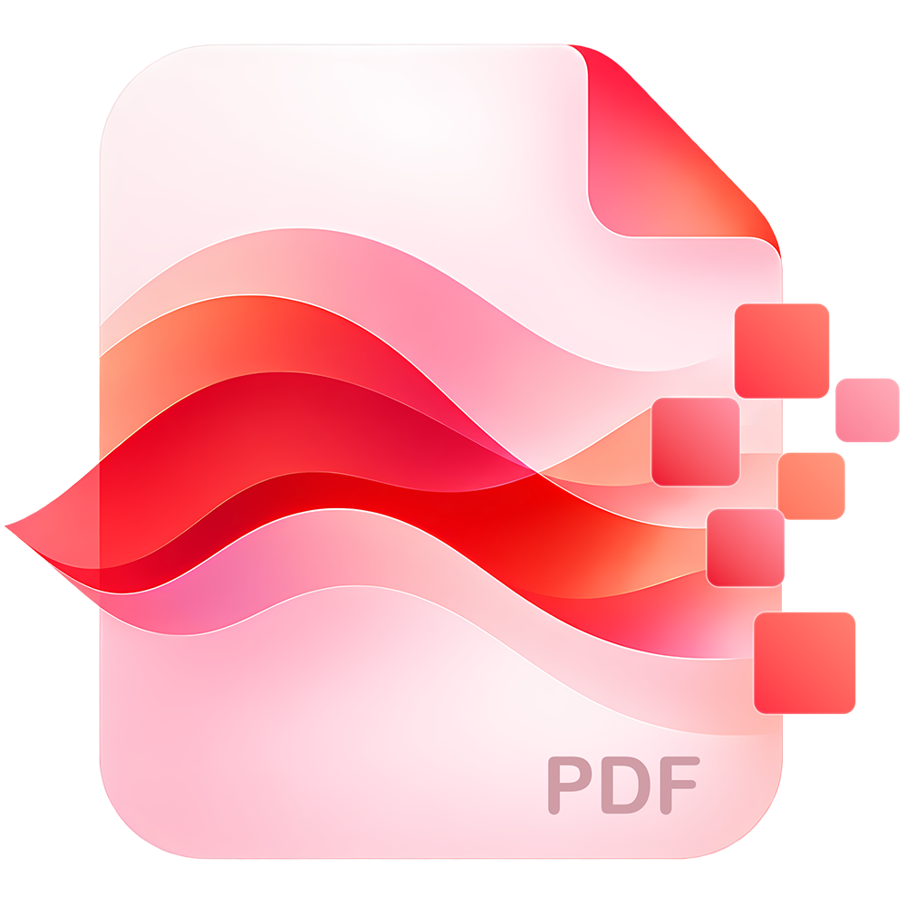

 
 <h2 align="center">PDF Blender</h2>
 
Keep PDFs readable. Make extraction harder.

    

  <a href="https://github.com/bitcookies/pdf-blender/blob/main/README.md">English</a> | <a href="https://github.com/bitcookies/pdf-blender/blob/main/README.zh-CN.md">简体中文</a>

## Info

PDF Blender helps you keep PDFs readable while making their content harder to copy or extract. Adjust page sizes, flatten pages into images, add watermarks, customize the copy layer, and set metadata or reader permissions. Your PDFs stay on your device while you work. PDF Blender is not encryption or DRM and cannot stop screenshots, OCR, or every form of copying.

## Install

Get it for free from the Microsoft Store.

  

## Features

- Resize pages to A4 and other standard paper sizes, or normalize their widths.
- Flatten pages into images with adjustable quality.
- Add a single large watermark or repeated small watermarks.
- Shape the copy layer with layout changes, random Unicode, digits, letters, or custom warning text.
- Apply pixel noise, texture changes, and geometric perturbation.
- Add hidden prompt text for research and experimentation, without promising a particular AI response.
- Set document metadata, copyright information, and reader permissions.
- Process PDFs locally without uploading document content.

## Screenshot

## Privacy and Limitations

PDF Blender does not upload PDF content. It is designed to make copying and extraction more difficult, but it does not provide encryption, access control, or DRM. It cannot prevent screenshots, OCR, or every other way of copying content. See the [Privacy Policy](https://pdf-blender.vercel.app/privacy).

## License

The code is available under the [MIT license](https://github.com/bitcookies/pdf-blender/blob/master/LICENSE)
